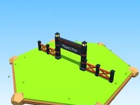

# Portail Player’s Pen rouge

Entrée d’enclos avec lanternes et panneau.

- **Catégorie** : [Enclos](Enclos.md)
- **Type** : Modèle low-poly
- **Taille** : 45 × 14 × 3 studs

## Variantes

- [Portail Player’s Pen bois](Portail%20Player%E2%80%99s%20Pen%20bois.md)
- [Portail Player’s Pen blanc](Portail%20Player%E2%80%99s%20Pen%20blanc.md)
- [Portail Player’s Pen bleu](Portail%20Player%E2%80%99s%20Pen%20bleu.md)
- [Portail Player’s Pen rose](Portail%20Player%E2%80%99s%20Pen%20rose.md)
- [Portail Player’s Pen or](Portail%20Player%E2%80%99s%20Pen%20or.md)
