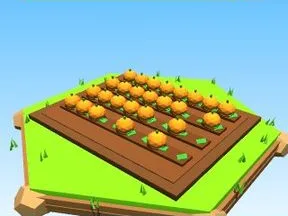

# Champ de citrouilles

Parcelle de citrouilles en rangées.

- **Catégorie** : [Général](G%C3%A9n%C3%A9ral.md)
- **Type** : Modèle low-poly
- **Taille** : 20 × 3 × 16 studs

## Variantes

- [Champ de blé](Champ%20de%20bl%C3%A9.md)
- [Champ de carottes](Champ%20de%20carottes.md)
- [Champ de choux](Champ%20de%20choux.md)
