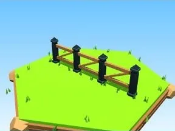

# Clôture ranch bois

Segment de clôture ranch avec croisillons.

- **Catégorie** : [Général](G%C3%A9n%C3%A9ral.md)
- **Type** : Modèle low-poly
- **Taille** : 20 × 6 × 2 studs

## Variantes

- [Clôture ranch blanche](Cl%C3%B4ture%20ranch%20blanche.md)
- [Clôture ranch rouge](Cl%C3%B4ture%20ranch%20rouge.md)
- [Clôture ranch bleue](Cl%C3%B4ture%20ranch%20bleue.md)
