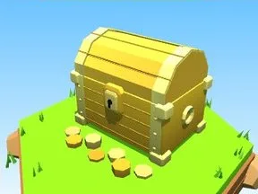

# Coffre doré

Coffre au trésor générique.

- **Catégorie** : [Général](G%C3%A9n%C3%A9ral.md)
- **Type** : Modèle low-poly
- **Taille** : 5 × 4 × 5 studs

## Variantes

- [Coffre en bois](Coffre%20en%20bois.md)
- [Coffre rouge](Coffre%20rouge.md)
