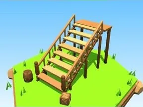

# Escalier en bois

Escalier ouvert en bois avec limons, rampe et palier sur poteaux.

- **Catégorie** : [Général](G%C3%A9n%C3%A9ral.md)
- **Type** : Modèle low-poly
- **Taille** : 9 × 8 × 12 studs
