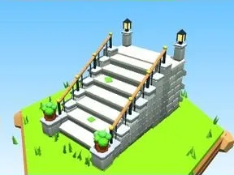

# Escalier en pierre

Escalier monumental : marches à nez, joues en pierre, rambardes, palier avec lanternes et pots de fleurs.

- **Catégorie** : [Général](G%C3%A9n%C3%A9ral.md)
- **Type** : Modèle low-poly
- **Taille** : 9 × 10 × 15 studs
