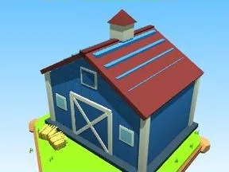

# Grange bleue

Variante bleue de la grange.

- **Catégorie** : [Général](G%C3%A9n%C3%A9ral.md)
- **Type** : Modèle low-poly
- **Taille** : 27 × 26 × 25 studs

## Variantes

- [Grange rouge](Grange%20rouge.md)
