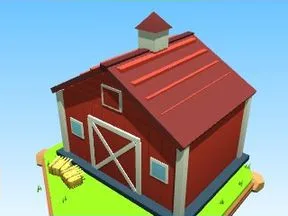

# Grange rouge

Grange à toit en pente et portes en X.

- **Catégorie** : [Général](G%C3%A9n%C3%A9ral.md)
- **Type** : Modèle low-poly
- **Taille** : 27 × 26 × 25 studs

## Variantes

- [Grange bleue](Grange%20bleue.md)
