# Général

**107 éléments**

| Aperçu | Élément | Infos |
| --- | --- | --- |
|  | [Tonneau](Tonneau.md) | Modèle low-poly · 3 × 3 × 3 |
|  | [Pile de tonneaux](Pile%20de%20tonneaux.md) | Modèle low-poly · 6 × 5 × 4 |
|  | [Caisse](Caisse.md) | Modèle low-poly · 3 × 3 × 3 |
|  | [Caisse renforcée](Caisse%20renforc%C3%A9e.md) | Modèle low-poly · 3 × 3 × 3 |
|  | [Caisse dorée](Caisse%20dor%C3%A9e.md) | Modèle low-poly · 5 × 3 × 5 |
|  | [Caisse sombre](Caisse%20sombre.md) | Modèle low-poly · 3 × 3 × 3 |
|  | [Caisse ouverte (brainrot)](Caisse%20ouverte%20%28brainrot%29.md) | Modèle low-poly · 4 × 6 × 3 |
|  | [Caisse de fruits](Caisse%20de%20fruits.md) | Modèle low-poly · 4 × 4 × 3 |
|  | [Caisse de gemmes](Caisse%20de%20gemmes.md) | Modèle low-poly · 4 × 5 × 3 |
|  | [Pile de caisses](Pile%20de%20caisses.md) | Modèle low-poly · 7 × 4 × 4 |
|  | [Banc](Banc%20%C2%B7%20G%C3%A9n%C3%A9ral.md) | Modèle low-poly · 5 × 3 × 2 |
|  | [Table et chaises](Table%20et%20chaises.md) | Modèle low-poly · 5 × 3 × 5 |
| 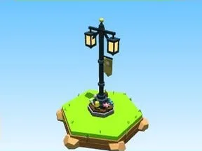 | [Lampadaire doré](Lampadaire%20dor%C3%A9.md) | Modèle low-poly · 4 × 11 × 3 |
| 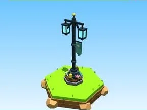 | [Lampadaire cyan](Lampadaire%20cyan.md) | Modèle low-poly · 4 × 11 × 3 |
|  | [Lampadaire rose](Lampadaire%20rose.md) | Modèle low-poly · 4 × 11 × 3 |
|  | [Lampadaire vert](Lampadaire%20vert.md) | Modèle low-poly · 4 × 11 × 3 |
|  | [Lampadaire violet](Lampadaire%20violet.md) | Modèle low-poly · 4 × 11 × 3 |
|  | [Panneau directionnel](Panneau%20directionnel.md) | Modèle low-poly · 8 × 10 × 8 |
|  | [Panneau d’affichage](Panneau%20d%E2%80%99affichage.md) | Modèle low-poly · 7 × 7 × 2 |
|  | [Grand panneau](Grand%20panneau.md) | Modèle low-poly · 15 × 17 × 2 |
|  | [Clôture ranch bois](Cl%C3%B4ture%20ranch%20bois.md) | Modèle low-poly · 20 × 6 × 2 |
| 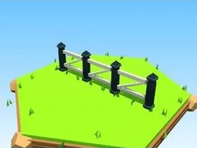 | [Clôture ranch blanche](Cl%C3%B4ture%20ranch%20blanche.md) | Modèle low-poly · 20 × 6 × 2 |
| 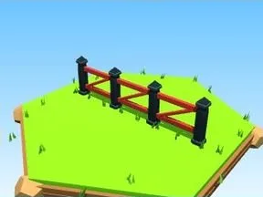 | [Clôture ranch rouge](Cl%C3%B4ture%20ranch%20rouge.md) | Modèle low-poly · 20 × 6 × 2 |
| 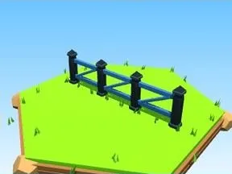 | [Clôture ranch bleue](Cl%C3%B4ture%20ranch%20bleue.md) | Modèle low-poly · 20 × 6 × 2 |
|  | [Clôture à piquets](Cl%C3%B4ture%20%C3%A0%20piquets.md) | Modèle low-poly · 17 × 5 × 2 |
|  | [Muret en pierre](Muret%20en%20pierre.md) | Modèle low-poly · 17 × 5 × 3 |
|  | [Grille métal](Grille%20m%C3%A9tal.md) | Modèle low-poly · 18 × 8 × 3 |
|  | [Mur de briques](Mur%20de%20briques.md) | Modèle low-poly · 19 × 9 × 3 |
|  | [Rempart de château](Rempart%20de%20ch%C3%A2teau.md) | Modèle low-poly · 16 × 8 × 4 |
|  | [Palissade](Palissade.md) | Modèle low-poly · 16 × 7 × 4 |
|  | [Haie taillée](Haie%20taill%C3%A9e.md) | Modèle low-poly · 18 × 5 × 4 |
|  | [Escalier en pierre](Escalier%20en%20pierre.md) | Modèle low-poly · 9 × 10 × 15 |
|  | [Escalier en bois](Escalier%20en%20bois.md) | Modèle low-poly · 9 × 8 × 12 |
|  | [Escalier en colimaçon](Escalier%20en%20colima%C3%A7on.md) | Modèle low-poly · 9 × 15 × 8 |
|  | [Pont en bois](Pont%20en%20bois.md) | Modèle low-poly · 25 × 5 × 9 |
|  | [Puits](Puits.md) | Modèle low-poly · 8 × 9 × 7 |
|  | [Feu de camp](Feu%20de%20camp.md) | Modèle low-poly · 9 × 6 × 6 |
|  | [Tente rouge](Tente%20rouge.md) | Modèle low-poly · 8 × 5 × 10 |
|  | [Tente bleue](Tente%20bleue.md) | Modèle low-poly · 8 × 5 × 10 |
| 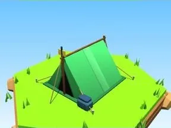 | [Tente verte](Tente%20verte.md) | Modèle low-poly · 8 × 5 × 10 |
| 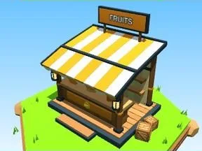 | [Stand FRUITS](Stand%20FRUITS.md) | Modèle low-poly · 18 × 15 × 13 |
| 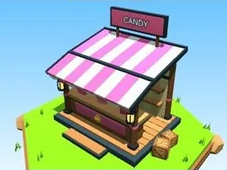 | [Stand CANDY](Stand%20CANDY.md) | Modèle low-poly · 18 × 15 × 13 |
| 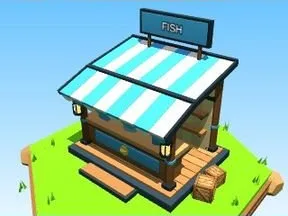 | [Stand FISH](Stand%20FISH.md) | Modèle low-poly · 18 × 15 × 13 |
|  | [Stand POTIONS](Stand%20POTIONS.md) | Modèle low-poly · 18 × 15 × 13 |
|  | [Stand TOOLS](Stand%20TOOLS.md) | Modèle low-poly · 18 × 15 × 13 |
| 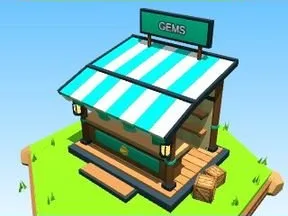 | [Stand GEMS](Stand%20GEMS.md) | Modèle low-poly · 18 × 15 × 13 |
|  | [Drapeau rouge](Drapeau%20rouge.md) | Modèle low-poly · 7 × 15 × 2 |
|  | [Drapeau bleu](Drapeau%20bleu.md) | Modèle low-poly · 7 × 15 × 2 |
| 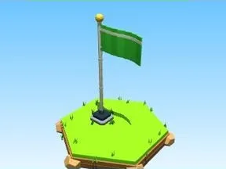 | [Drapeau vert](Drapeau%20vert.md) | Modèle low-poly · 7 × 15 × 2 |
| 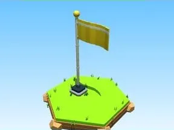 | [Drapeau jaune](Drapeau%20jaune.md) | Modèle low-poly · 7 × 15 × 2 |
|  | [Drapeau violet](Drapeau%20violet.md) | Modèle low-poly · 7 × 15 × 2 |
|  | [Bouquet de ballons](Bouquet%20de%20ballons.md) | Modèle low-poly · 5 × 12 × 6 |
|  | [Poubelle](Poubelle.md) | Modèle low-poly · 3 × 4 × 3 |
|  | [Boîte aux lettres](Bo%C3%AEte%20aux%20lettres.md) | Modèle low-poly · 3 × 6 × 4 |
|  | [Statue dorée](Statue%20dor%C3%A9e.md) | Modèle low-poly · 8 × 10 × 7 |
|  | [Colonne](Colonne.md) | Modèle low-poly · 3 × 11 × 3 |
|  | [Ruines](Ruines.md) | Modèle low-poly · 12 × 10 × 12 |
| 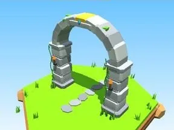 | [Arche en pierre](Arche%20en%20pierre.md) | Modèle low-poly · 12 × 12 × 10 |
|  | [Pas japonais](Pas%20japonais.md) | Modèle low-poly · 17 × 2 × 7 |
|  | [Coffre en bois](Coffre%20en%20bois.md) | Modèle low-poly · 5 × 4 × 5 |
|  | [Coffre doré](Coffre%20dor%C3%A9.md) | Modèle low-poly · 5 × 4 × 5 |
|  | [Coffre rouge](Coffre%20rouge.md) | Modèle low-poly · 5 × 4 × 5 |
|  | [Tas de trésor](Tas%20de%20tr%C3%A9sor.md) | Modèle low-poly · 8 × 4 × 7 |
|  | [Piles de pièces](Piles%20de%20pi%C3%A8ces.md) | Modèle low-poly · 5 × 4 × 7 |
| 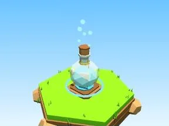 | [Potion bleue](Potion%20bleue.md) | Modèle low-poly · 4 × 7 × 4 |
|  | [Potion rose](Potion%20rose.md) | Modèle low-poly · 4 × 7 × 4 |
| 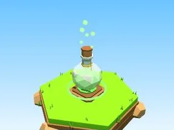 | [Potion verte](Potion%20verte.md) | Modèle low-poly · 4 × 7 × 4 |
|  | [Potion violette](Potion%20violette.md) | Modèle low-poly · 4 × 7 × 4 |
|  | [Potion dorée](Potion%20dor%C3%A9e.md) | Modèle low-poly · 4 × 7 × 4 |
| 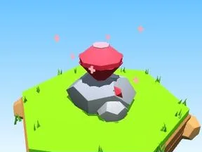 | [Rubis](Rubis.md) | Modèle low-poly · 6 × 5 × 5 |
|  | [Saphir](Saphir.md) | Modèle low-poly · 6 × 5 × 5 |
| 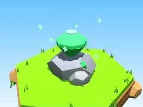 | [Émeraude](%C3%89meraude.md) | Modèle low-poly · 6 × 5 × 5 |
| 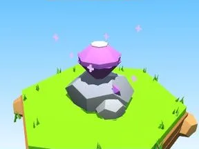 | [Améthyste](Am%C3%A9thyste.md) | Modèle low-poly · 6 × 5 × 5 |
|  | [Topaze](Topaze.md) | Modèle low-poly · 6 × 5 × 5 |
| 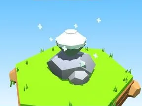 | [Diamant](Diamant.md) | Modèle low-poly · 6 × 5 × 5 |
| 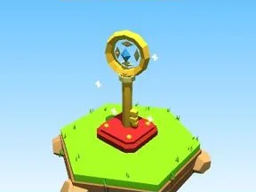 | [Clé dorée](Cl%C3%A9%20dor%C3%A9e.md) | Modèle low-poly · 4 × 7 × 3 |
|  | [Trophée or](Troph%C3%A9e%20or.md) | Modèle low-poly · 5 × 6 × 4 |
|  | [Trophée argent](Troph%C3%A9e%20argent.md) | Modèle low-poly · 5 × 6 × 4 |
|  | [Trophée bronze](Troph%C3%A9e%20bronze.md) | Modèle low-poly · 5 × 6 × 4 |
|  | [Podium 1-2-3](Podium%201-2-3.md) | Modèle low-poly · 14 × 6 × 7 |
|  | [Spawn pad](Spawn%20pad.md) | Modèle low-poly · 11 × 6 × 11 |
| 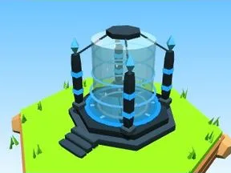 | [Téléporteur bleu](T%C3%A9l%C3%A9porteur%20bleu.md) | Modèle low-poly · 9 × 7 × 10 |
| 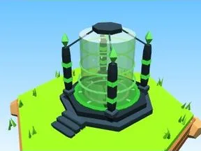 | [Téléporteur vert](T%C3%A9l%C3%A9porteur%20vert.md) | Modèle low-poly · 9 × 7 × 10 |
|  | [Téléporteur violet](T%C3%A9l%C3%A9porteur%20violet.md) | Modèle low-poly · 9 × 7 × 10 |
| 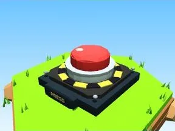 | [Bouton géant](Bouton%20g%C3%A9ant.md) | Modèle low-poly · 5 × 3 × 6 |
| 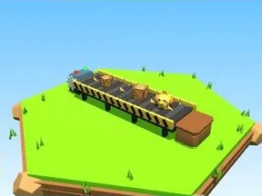 | [Tapis roulant](Tapis%20roulant.md) | Modèle low-poly · 19 × 4 × 5 |
| 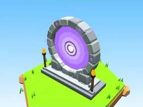 | [Portail violet](Portail%20violet.md) | Modèle low-poly · 13 × 14 × 5 |
| 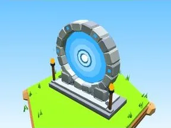 | [Portail bleu](Portail%20bleu.md) | Modèle low-poly · 13 × 14 × 5 |
|  | [Portail orange](Portail%20orange.md) | Modèle low-poly · 13 × 14 × 5 |
|  | [Maison rouge](Maison%20rouge.md) | Modèle low-poly · 11 × 12 × 12 |
|  | [Maison bleue](Maison%20bleue.md) | Modèle low-poly · 11 × 12 × 12 |
|  | [Maison jaune](Maison%20jaune.md) | Modèle low-poly · 11 × 12 × 12 |
|  | [Tour](Tour.md) | Modèle low-poly · 9 × 22 × 9 |
|  | [Ponton](Ponton.md) | Modèle low-poly · 19 × 5 × 10 |
|  | [Bateau](Bateau.md) | Modèle low-poly · 24 × 15 × 13 |
|  | [Grange rouge](Grange%20rouge.md) | Modèle low-poly · 27 × 26 × 25 |
|  | [Grange bleue](Grange%20bleue.md) | Modèle low-poly · 27 × 26 × 25 |
|  | [Silo](Silo.md) | Modèle low-poly · 10 × 28 × 10 |
|  | [Moulin](Moulin.md) | Modèle low-poly · 28 × 36 × 14 |
| 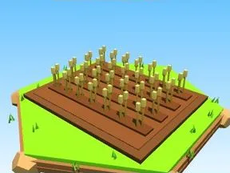 | [Champ de blé](Champ%20de%20bl%C3%A9.md) | Modèle low-poly · 20 × 4 × 16 |
|  | [Champ de carottes](Champ%20de%20carottes.md) | Modèle low-poly · 20 × 2 × 16 |
| 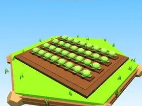 | [Champ de choux](Champ%20de%20choux.md) | Modèle low-poly · 20 × 2 × 16 |
|  | [Champ de citrouilles](Champ%20de%20citrouilles.md) | Modèle low-poly · 20 × 3 × 16 |
|  | [Épouvantail](%C3%89pouvantail.md) | Modèle low-poly · 5 × 8 × 3 |
|  | [Tracteur](Tracteur.md) | Modèle low-poly · 7 × 7 × 9 |
|  | [Meule de foin](Meule%20de%20foin.md) | Modèle low-poly · 7 × 4 × 3 |
| 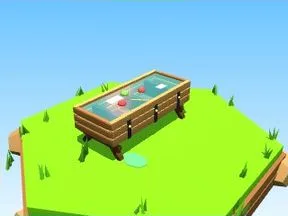 | [Abreuvoir](Abreuvoir%20%C2%B7%20G%C3%A9n%C3%A9ral.md) | Modèle low-poly · 4 × 2 × 8 |

Retour : [Rake Vault](../Rake%20Vault.md)
