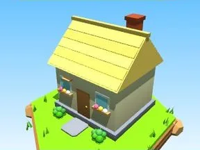

# Maison jaune

Petite maison avec toit, cheminée et fenêtres.

- **Catégorie** : [Général](G%C3%A9n%C3%A9ral.md)
- **Type** : Modèle low-poly
- **Taille** : 11 × 12 × 12 studs

## Variantes

- [Maison rouge](Maison%20rouge.md)
- [Maison bleue](Maison%20bleue.md)
