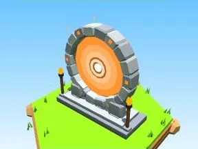

# Portail orange

Portail en pierre avec vortex coloré.

- **Catégorie** : [Général](G%C3%A9n%C3%A9ral.md)
- **Type** : Modèle low-poly
- **Taille** : 13 × 14 × 5 studs

## Variantes

- [Portail violet](Portail%20violet.md)
- [Portail bleu](Portail%20bleu.md)
