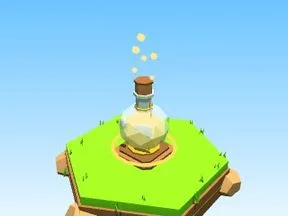

# Potion dorée

Fiole de potion lumineuse.

- **Catégorie** : [Général](G%C3%A9n%C3%A9ral.md)
- **Type** : Modèle low-poly
- **Taille** : 4 × 7 × 4 studs

## Variantes

- [Potion bleue](Potion%20bleue.md)
- [Potion rose](Potion%20rose.md)
- [Potion verte](Potion%20verte.md)
- [Potion violette](Potion%20violette.md)
