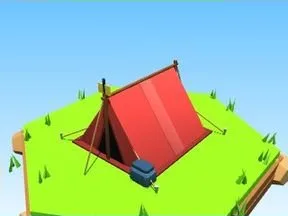

# Tente rouge

Tente de camping avec piquets.

- **Catégorie** : [Général](G%C3%A9n%C3%A9ral.md)
- **Type** : Modèle low-poly
- **Taille** : 8 × 5 × 10 studs

## Variantes

- [Tente bleue](Tente%20bleue.md)
- [Tente verte](Tente%20verte.md)
