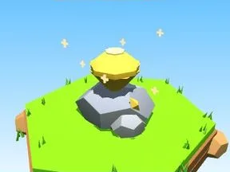

# Topaze

Grosse gemme taillée sur un rocher.

- **Catégorie** : [Général](G%C3%A9n%C3%A9ral.md)
- **Type** : Modèle low-poly
- **Taille** : 6 × 5 × 5 studs

## Variantes

- [Rubis](Rubis.md)
- [Saphir](Saphir.md)
- [Émeraude](%C3%89meraude.md)
- [Améthyste](Am%C3%A9thyste.md)
- [Diamant](Diamant.md)
