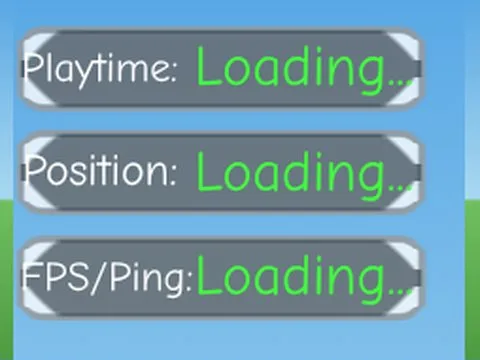

# Admin & debug

Sous-catégorie de [Interfaces](../Interfaces.md) · **5 éléments**

| Aperçu | Élément | Infos |
| --- | --- | --- |
|  | [Admin Panel · Bakery Simulator](Admin%20Panel%20%C2%B7%20Bakery%20Simulator.md) | Interface (ScreenGui) · 11 éléments UI |
|  | [Debug Mode · Hatching Simulator](Debug%20Mode%20%C2%B7%20Hatching%20Simulator%20%C2%B7%20Admin%20&%20debug.md) | Interface (ScreenGui) · 13 éléments UI |
|  | [F2Admin Button · Lib perso](F2Admin%20Button%20%C2%B7%20Lib%20perso.md) | Interface (ScreenGui) · 3 éléments UI |
|  | [F2 Admin StarterGui (by Erick and dreyy)](F2%20Admin%20StarterGui%20%28by%20Erick%20and%20dreyy%29.md) | Interface (ScreenGui) · 1 fichier · 11 Ko |
|  | [Dashboard GUI – XaroN Panel](Dashboard%20GUI%20%E2%80%93%20XaroN%20Panel.md) | Interface (ScreenGui) · 1 fichier · 25 Ko |
