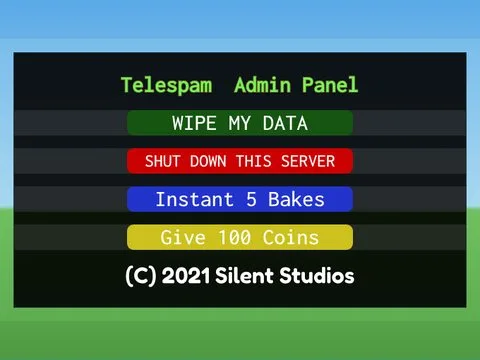

# Admin Panel · Bakery Simulator

Interface « Admin Panel » du jeu Bakery Simulator. 11 éléments UI.

- **Catégorie** : [Interfaces](../Interfaces.md)
- **Sous-catégorie** : [Admin & debug](Admin%20%26%20debug.md)
- **Type** : Interface (ScreenGui)
- **Contenu** : 11 éléments UI
- **Jeu d'origine** : Bakery Simulator
- **Fichier source** : `ui/ByType/Admin_Debug/BakerySim_AdminPanel.rbxm` (dans ta bibliothèque `rblx\lib`)
