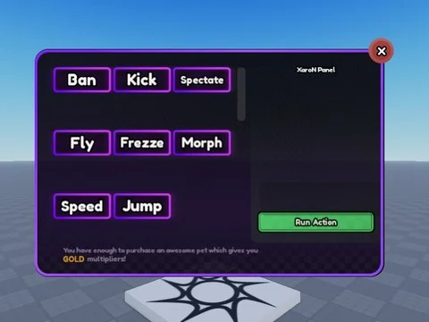

# Dashboard GUI – XaroN Panel

ScreenGui « Panel » = XaroN Panel, panneau admin (boutons Ban, Kick, Spectate, Fly, Freeze…) ; UI seule, aucun script.

- **Catégorie** : [Interfaces](../Interfaces.md)
- **Sous-catégorie** : [Admin & debug](Admin%20&%20debug.md)
- **Type** : Interface (ScreenGui)
- **Contenu** : 1 fichier · 25 Ko
- **Fichier source** : `Assets/ui/ByType/Admin_Debug/dashboard gui (XaroN Panel).rbxm` (dans le vault)
