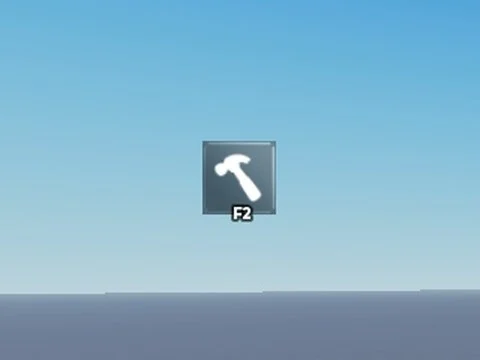

# F2 Admin StarterGui (by Erick and dreyy)

ScreenGui « F2 Admin by erick » : bouton admin (ImageButton) avec 2 LocalScripts, crédits Erick and dreyy.

- **Catégorie** : [Interfaces](../Interfaces.md)
- **Sous-catégorie** : [Admin & debug](Admin%20&%20debug.md)
- **Type** : Interface (ScreenGui)
- **Contenu** : 1 fichier · 11 Ko
- **Fichier source** : `Assets/ui/ByType/Admin_Debug/F2 StarterGui by Erick and dreyy.rbxm` (dans le vault)

> ⚠️ **Sécurité** : allowedIds codé en dur (7316226291) et vérifié seulement côté client : remplacer l’ID et ne pas s’y fier pour la sécurité.
