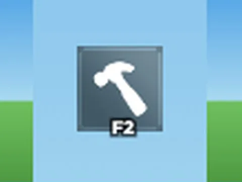

# F2Admin Button · Lib perso

Interface « F2Admin Button » du jeu Lib perso. 3 éléments UI.

- **Catégorie** : [Interfaces](../Interfaces.md)
- **Sous-catégorie** : [Admin & debug](Admin%20&%20debug.md)
- **Type** : Interface (ScreenGui)
- **Contenu** : 3 éléments UI
- **Jeu d'origine** : Lib perso
- **Fichier source** : `Assets/ui/ByType/Admin_Debug/Lib_F2AdminButton.rbxm` (dans le vault)
