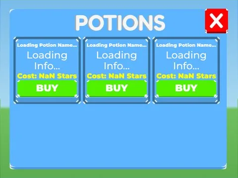
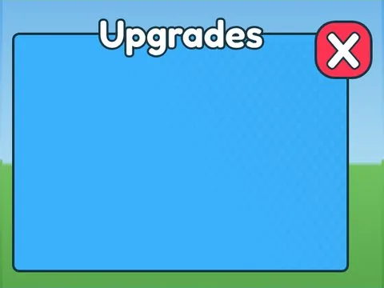
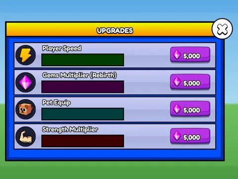

# Améliorations

Sous-catégorie de [Interfaces](../Interfaces.md) · **8 éléments**

| Aperçu | Élément | Infos |
| --- | --- | --- |
|  | [Golden Machine · Pet Pharmica](Golden%20Machine%20%C2%B7%20Pet%20Pharmica.md) | Interface (ScreenGui) · 4 éléments UI |
|  | [Potions · Tapping Lords](Potions%20%C2%B7%20Tapping%20Lords%20%C2%B7%20Am%C3%A9liorations.md) | Interface (ScreenGui) · 35 éléments UI |
|  | [Upgrades · Mining Masters](Upgrades%20%C2%B7%20Mining%20Masters.md) | Interface (ScreenGui) · 8 éléments UI |
|  | [Upgrades · Pet Pharmica](Upgrades%20%C2%B7%20Pet%20Pharmica.md) | Interface (ScreenGui) · 20 éléments UI |
|  | [Upgrades · Punch Simulator](Upgrades%20%C2%B7%20Punch%20Simulator.md) | Interface (ScreenGui) · 46 éléments UI |
|  | [Upgrades · Tapping Lords](Upgrades%20%C2%B7%20Tapping%20Lords.md) | Interface (ScreenGui) · 83 éléments UI |
|  | [Upgrades · Training Simulator](Upgrades%20%C2%B7%20Training%20Simulator.md) | Interface (ScreenGui) · 46 éléments UI |
|  | [Upgrades Potions · Rebirth Champions X](Upgrades%20Potions%20%C2%B7%20Rebirth%20Champions%20X.md) | Interface (ScreenGui) · 96 éléments UI |
