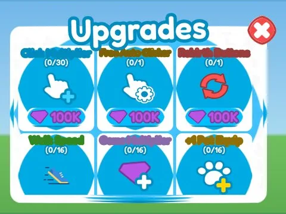

# Upgrades Potions · Rebirth Champions X

Interface « Upgrades Potions » du jeu Rebirth Champions X. 96 éléments UI.

- **Catégorie** : [Interfaces](../Interfaces.md)
- **Sous-catégorie** : [Améliorations](Am%C3%A9liorations.md)
- **Type** : Interface (ScreenGui)
- **Contenu** : 96 éléments UI
- **Jeu d'origine** : Rebirth Champions X
- **Fichier source** : `Assets/ui/ByType/Upgrades/RebirthChampionsX_UpgradesPotions.rbxm` (dans le vault)
