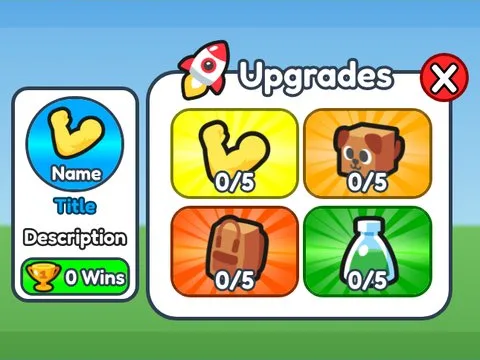

# Upgrades · Training Simulator

Interface « Upgrades » du jeu Training Simulator. 46 éléments UI.

- **Catégorie** : [Interfaces](../Interfaces.md)
- **Sous-catégorie** : [Améliorations](Am%C3%A9liorations.md)
- **Type** : Interface (ScreenGui)
- **Contenu** : 46 éléments UI
- **Jeu d'origine** : Training Simulator
- **Fichier source** : `Assets/ui/ByType/Upgrades/TrainingSim_Upgrades.rbxm` (dans le vault)
