# Boutiques

Sous-catégorie de [Interfaces](../Interfaces.md) · **17 éléments**

| Aperçu | Élément | Infos |
| --- | --- | --- |
|  | [Event Shop · Rebirth Champions X](Event%20Shop%20%C2%B7%20Rebirth%20Champions%20X.md) | Interface (ScreenGui) · 68 éléments UI |
| 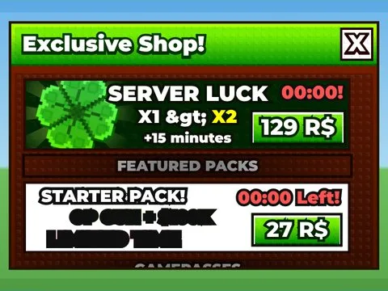 | [Exclusive Shop · Shoot A Brainrot](Exclusive%20Shop%20%C2%B7%20Shoot%20A%20Brainrot.md) | Interface (ScreenGui) · 115 éléments UI |
| 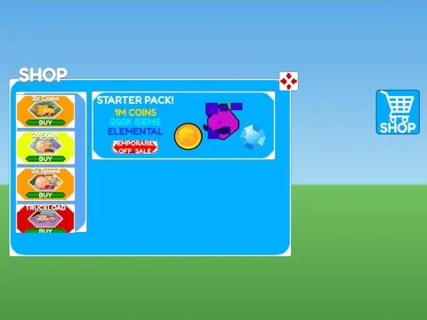 | [Gamepass Shop · Hatching Simulator](Gamepass%20Shop%20%C2%B7%20Hatching%20Simulator.md) | Interface (ScreenGui) · 109 éléments UI |
| 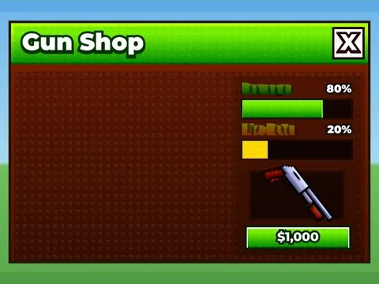 | [Gun Shop · Shoot A Brainrot](Gun%20Shop%20%C2%B7%20Shoot%20A%20Brainrot.md) | Interface (ScreenGui) · 32 éléments UI |
| 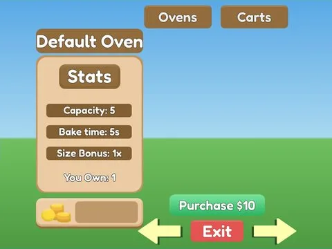 | [Item Shop · Bakery Simulator](Item%20Shop%20%C2%B7%20Bakery%20Simulator.md) | Interface (ScreenGui) · 33 éléments UI |
| 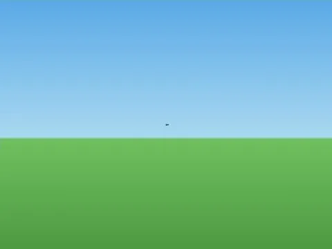 | [Item Store · Tweeting Simulator](Item%20Store%20%C2%B7%20Tweeting%20Simulator.md) | Interface (ScreenGui) · 34 éléments UI |
| 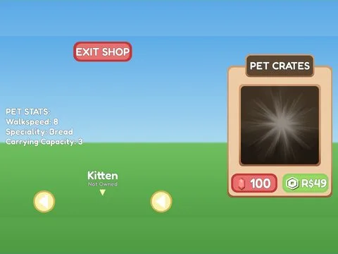 | [Pet Shop · Bakery Simulator](Pet%20Shop%20%C2%B7%20Bakery%20Simulator.md) | Interface (ScreenGui) · 43 éléments UI |
| 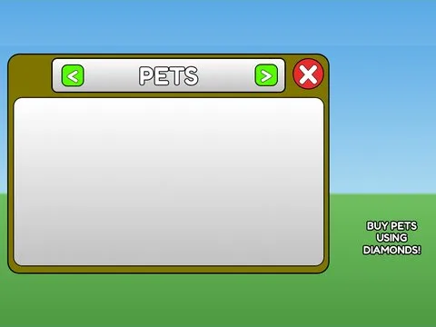 | [Pet Shop · Cashgrab Bridge](Pet%20Shop%20%C2%B7%20Cashgrab%20Bridge.md) | Interface (ScreenGui) · 14 éléments UI |
| 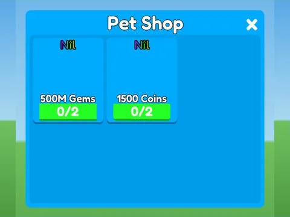 | [Pet Shop · Pet Pharmica](Pet%20Shop%20%C2%B7%20Pet%20Pharmica.md) | Interface (ScreenGui) · 21 éléments UI |
| 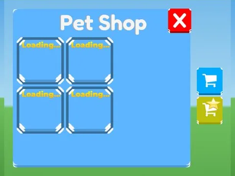 | [Pet Shops · Tapping Lords](Pet%20Shops%20%C2%B7%20Tapping%20Lords.md) | Interface (ScreenGui) · 70 éléments UI |
|  | [Shop · Pet Pharmica](Shop%20%C2%B7%20Pet%20Pharmica.md) | Interface (ScreenGui) · 201 éléments UI |
| 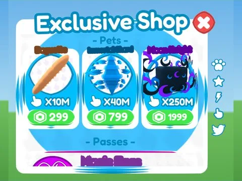 | [Shop · Rebirth Champions X](Shop%20%C2%B7%20Rebirth%20Champions%20X.md) | Interface (ScreenGui) · 316 éléments UI |
| 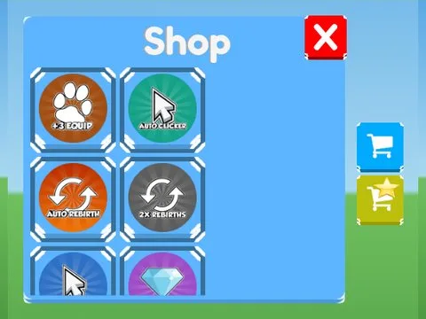 | [Shop · Tapping Lords](Shop%20%C2%B7%20Tapping%20Lords.md) | Interface (ScreenGui) · 82 éléments UI |
| 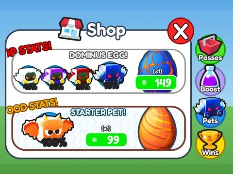 | [Shop · Training Simulator](Shop%20%C2%B7%20Training%20Simulator.md) | Interface (ScreenGui) · 84 éléments UI |
| 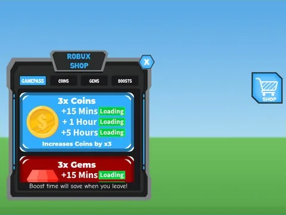 | [Shop Boosts · Robot Simulator](Shop%20Boosts%20%C2%B7%20Robot%20Simulator.md) | Interface (ScreenGui) · 111 éléments UI |
| 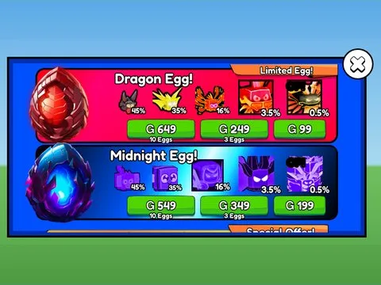 | [Store · Punch Simulator](Store%20%C2%B7%20Punch%20Simulator.md) | Interface (ScreenGui) · 351 éléments UI |
| 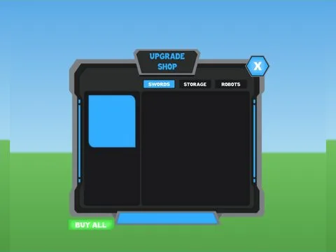 | [Weapon Skill Shop · Robot Simulator](Weapon%20Skill%20Shop%20%C2%B7%20Robot%20Simulator.md) | Interface (ScreenGui) · 12 éléments UI |
