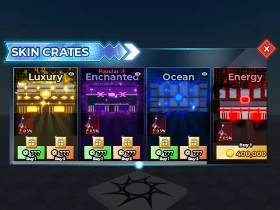

# Crates GUI (Lootbox)

ScreenGui « Lootbox » d’ouverture/achat de caisses (frame Main) ; aucun script.

- **Catégorie** : [Interfaces](../Interfaces.md)
- **Sous-catégorie** : [Boutiques](Boutiques.md)
- **Type** : Interface (ScreenGui)
- **Contenu** : 1 fichier · 24 Ko
- **Fichier source** : `Assets/ui/ByType/Shop_Store/CRATES GUI.rbxm` (dans le vault)
