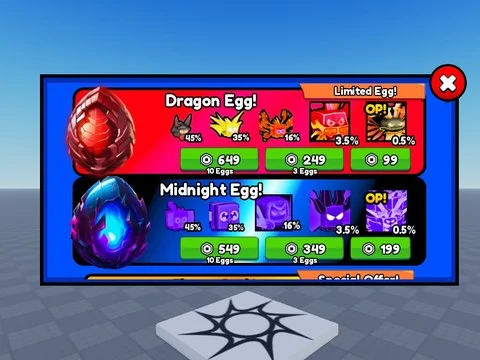

# Shop GUI (Store)

ScreenGui « Store » (boutique complète + bouton Store) avec 15 scripts locaux.

- **Catégorie** : [Interfaces](../Interfaces.md)
- **Sous-catégorie** : [Boutiques](Boutiques.md)
- **Type** : Interface (ScreenGui)
- **Contenu** : 1 fichier · 42 Ko
- **Fichier source** : `Assets/ui/ByType/Shop_Store/shop_gui.rbxm` (dans le vault)
