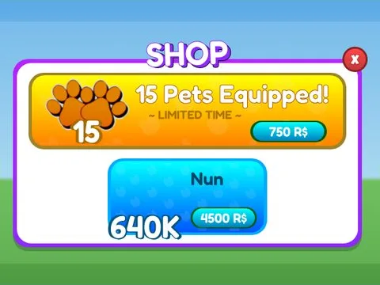

# Shop · Pet Pharmica

Interface « Shop » du jeu Pet Pharmica. 201 éléments UI.

- **Catégorie** : [Interfaces](../Interfaces.md)
- **Sous-catégorie** : [Boutiques](Boutiques.md)
- **Type** : Interface (ScreenGui)
- **Contenu** : 201 éléments UI
- **Jeu d'origine** : Pet Pharmica
- **Fichier source** : `Assets/ui/ByType/Shop_Store/PetPharmica_Shop.rbxm` (dans le vault)
