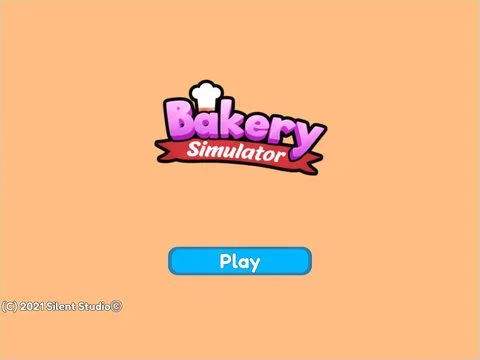

# Load · Bakery Simulator

Interface « Load » du jeu Bakery Simulator. 6 éléments UI.

- **Catégorie** : [Interfaces](../Interfaces.md)
- **Sous-catégorie** : [Chargement & intro](Chargement%20%26%20intro.md)
- **Type** : Interface (ScreenGui)
- **Contenu** : 6 éléments UI
- **Jeu d'origine** : Bakery Simulator
- **Fichier source** : `ui/ByType/Loading_Intro/BakerySim_Load.rbxm` (dans ta bibliothèque `rblx\lib`)
