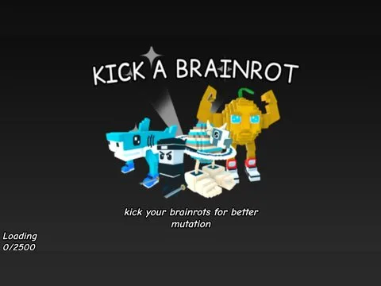

# Loading Brainrot · Lib perso

Interface « Loading Brainrot » du jeu Lib perso. 6 éléments UI.

- **Catégorie** : [Interfaces](../Interfaces.md)
- **Sous-catégorie** : [Chargement & intro](Chargement%20&%20intro.md)
- **Type** : Interface (ScreenGui)
- **Contenu** : 6 éléments UI
- **Jeu d'origine** : Lib perso
- **Fichier source** : `Assets/ui/ByType/Loading_Intro/Lib_Loading_Brainrot.rbxm` (dans le vault)
