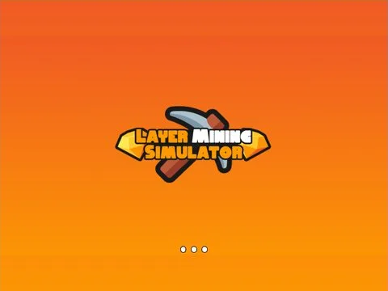

# Loading Screen · Mining Masters

Interface « Loading Screen » du jeu Mining Masters. 10 éléments UI.

- **Catégorie** : [Interfaces](../Interfaces.md)
- **Sous-catégorie** : [Chargement & intro](Chargement%20%26%20intro.md)
- **Type** : Interface (ScreenGui)
- **Contenu** : 10 éléments UI
- **Jeu d'origine** : Mining Masters
- **Fichier source** : `ui/ByType/Loading_Intro/MiningMasters_LoadingScreen.rbxm` (dans ta bibliothèque `rblx\lib`)
