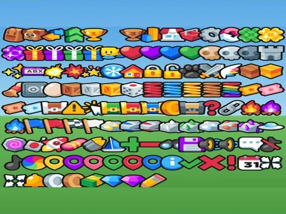
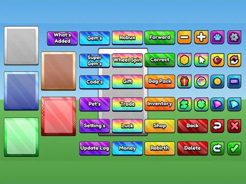

# Composants UI

Sous-catégorie de [Interfaces](../Interfaces.md) · **4 éléments**

| Aperçu | Élément | Infos |
| --- | --- | --- |
|  | [Buttons · Cryptic Games UI Pack](Buttons%20%C2%B7%20Cryptic%20Games%20UI%20Pack.md) | Interface (ScreenGui) · 40 éléments UI |
|  | [Images · Cryptic Games UI Pack](Images%20%C2%B7%20Cryptic%20Games%20UI%20Pack.md) | Interface (ScreenGui) · 121 éléments UI |
|  | [UIKit vortex tree · Lib perso](UIKit%20vortex%20tree%20%C2%B7%20Lib%20perso.md) | Interface (ScreenGui) · 105 éléments UI |
|  | [UIMega Pack · Lib perso](UIMega%20Pack%20%C2%B7%20Lib%20perso.md) | Interface (ScreenGui) · 115 éléments UI |
