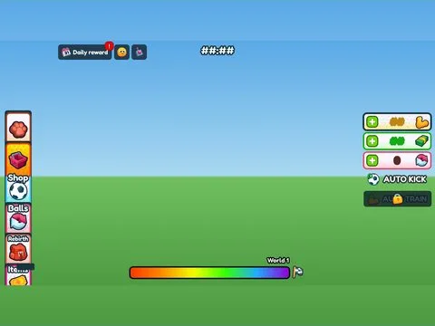

# UIKit vortex tree · Lib perso

Interface « UIKit vortex tree » du jeu Lib perso. 105 éléments UI.

- **Catégorie** : [Interfaces](../Interfaces.md)
- **Sous-catégorie** : [Composants UI](Composants%20UI.md)
- **Type** : Interface (ScreenGui)
- **Contenu** : 105 éléments UI
- **Jeu d'origine** : Lib perso
- **Fichier source** : `Assets/ui/ByType/Components_Kits/Lib_UIKit_vortex_tree.rbxm` (dans le vault)
