# Divers

Sous-catégorie de [Interfaces](../Interfaces.md) · **24 éléments**

| Aperçu | Élément | Infos |
| --- | --- | --- |
| 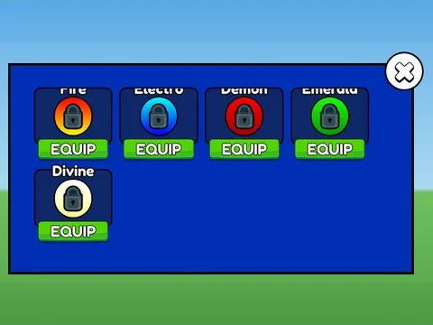 | [Auras · Punch Simulator](Auras%20%C2%B7%20Punch%20Simulator.md) | Interface (ScreenGui) · 34 éléments UI |
| 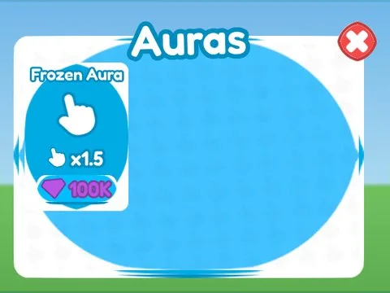 | [Auras · Rebirth Champions X](Auras%20%C2%B7%20Rebirth%20Champions%20X.md) | Interface (ScreenGui) · 21 éléments UI |
| 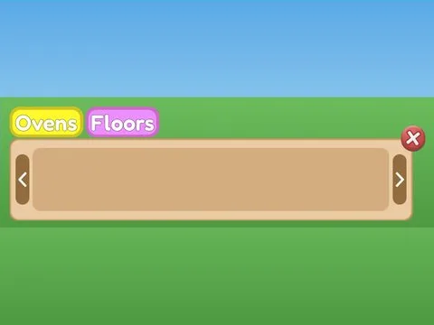 | [Build Editor · Bakery Simulator](Build%20Editor%20%C2%B7%20Bakery%20Simulator.md) | Interface (ScreenGui) · 12 éléments UI |
| 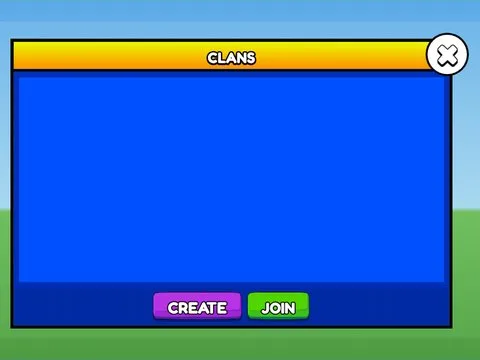 | [Clans · Punch Simulator](Clans%20%C2%B7%20Punch%20Simulator.md) | Interface (ScreenGui) · 17 éléments UI |
| 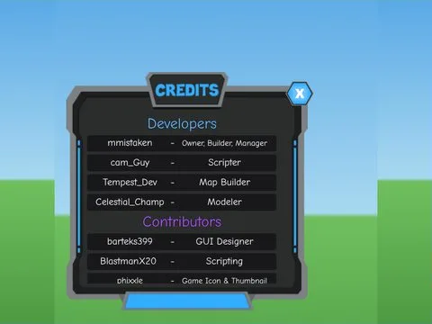 | [Credits Update Log · Robot Simulator](Credits%20Update%20Log%20%C2%B7%20Robot%20Simulator.md) | Interface (ScreenGui) · 63 éléments UI |
| 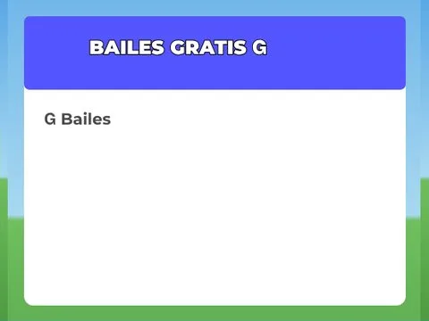 | [Dances · First Donations](Dances%20%C2%B7%20First%20Donations.md) | Interface (ScreenGui) · 6 éléments UI |
|  | [Discord Verification · Punch Simulator](Discord%20Verification%20%C2%B7%20Punch%20Simulator%20%C2%B7%20Divers.md) | Interface (ScreenGui) · 17 éléments UI |
| 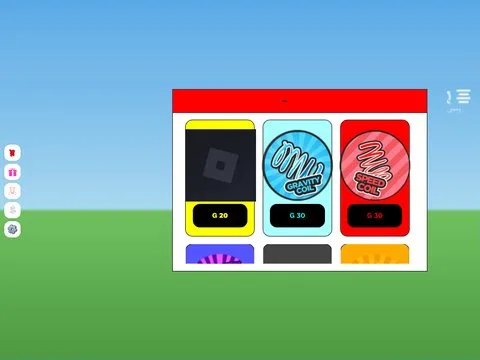 | [Edit Gui Full · First Donations](Edit%20Gui%20Full%20%C2%B7%20First%20Donations.md) | Interface (ScreenGui) · 64 éléments UI |
| 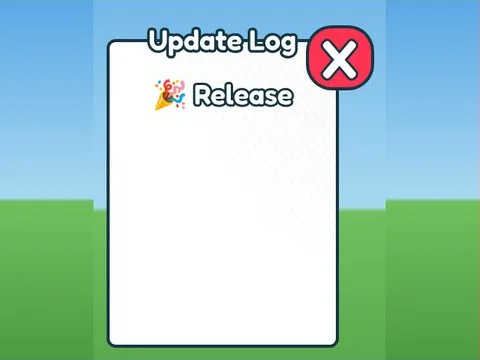 | [Feedback Updates Tuto · Mining Masters](Feedback%20Updates%20Tuto%20%C2%B7%20Mining%20Masters.md) | Interface (ScreenGui) · 8 éléments UI |
|  | [Frame UI Full · Tapping Lords](Frame%20UI%20Full%20%C2%B7%20Tapping%20Lords.md) | Interface (ScreenGui) · 418 éléments UI |
| 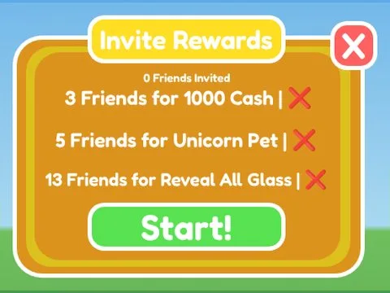 | [Invite Rewards · Glass Bridge](Invite%20Rewards%20%C2%B7%20Glass%20Bridge.md) | Interface (ScreenGui) · 15 éléments UI |
| 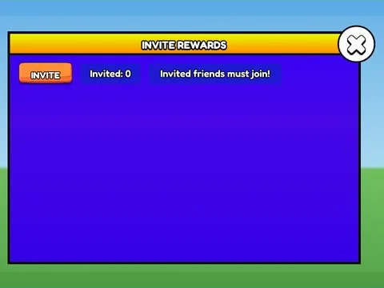 | [Invite Rewards · Punch Simulator](Invite%20Rewards%20%C2%B7%20Punch%20Simulator.md) | Interface (ScreenGui) · 19 éléments UI |
| 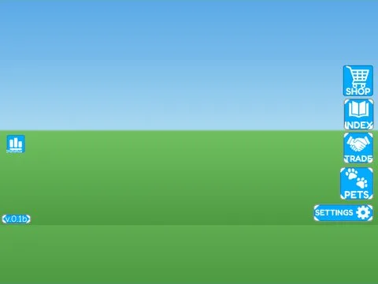 | [Main UI Full · Hatching Simulator](Main%20UI%20Full%20%C2%B7%20Hatching%20Simulator.md) | Interface (ScreenGui) · 35 éléments UI |
| 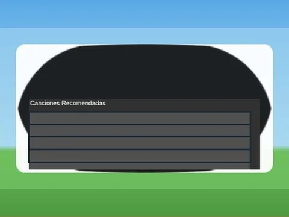 | [Music Player · First Donations](Music%20Player%20%C2%B7%20First%20Donations.md) | Interface (ScreenGui) · 13 éléments UI |
| 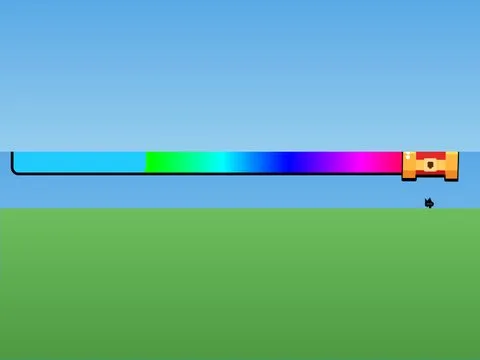 | [Race Reward · Glass Bridge](Race%20Reward%20%C2%B7%20Glass%20Bridge.md) | Interface (ScreenGui) · 6 éléments UI |
| 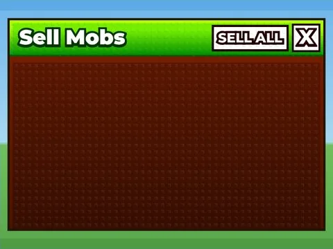 | [Sell Mobs · Shoot A Brainrot](Sell%20Mobs%20%C2%B7%20Shoot%20A%20Brainrot.md) | Interface (ScreenGui) · 17 éléments UI |
| 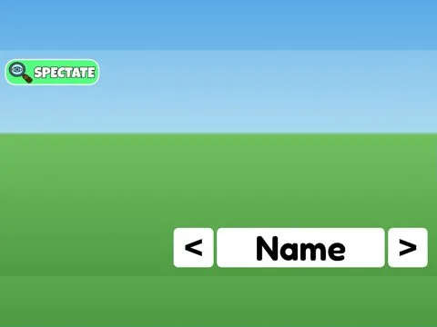 | [Spectate · Cashgrab Bridge](Spectate%20%C2%B7%20Cashgrab%20Bridge.md) | Interface (ScreenGui) · 7 éléments UI |
| 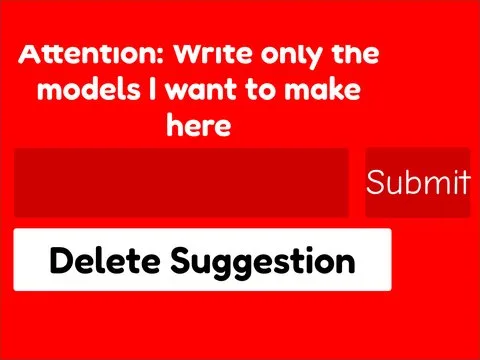 | [Suggestion Wall · Pet Pharmica](Suggestion%20Wall%20%C2%B7%20Pet%20Pharmica.md) | Interface (ScreenGui) · 5 éléments UI |
| 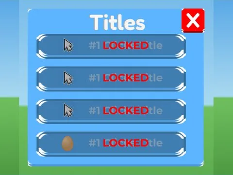 | [Titles · Tapping Lords](Titles%20%C2%B7%20Tapping%20Lords%20%C2%B7%20Divers.md) | Interface (ScreenGui) · 113 éléments UI |
| 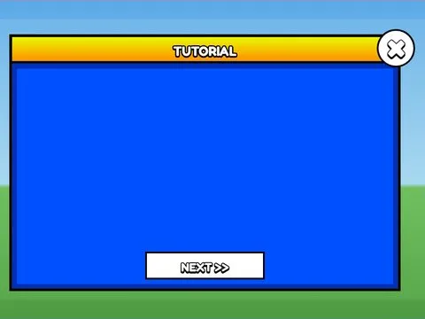 | [Tutorial · Punch Simulator](Tutorial%20%C2%B7%20Punch%20Simulator.md) | Interface (ScreenGui) · 16 éléments UI |
|  | [UIModules · Robot Simulator](UIModules%20%C2%B7%20Robot%20Simulator.md) | Interface (ScreenGui) · 96 éléments UI |
| 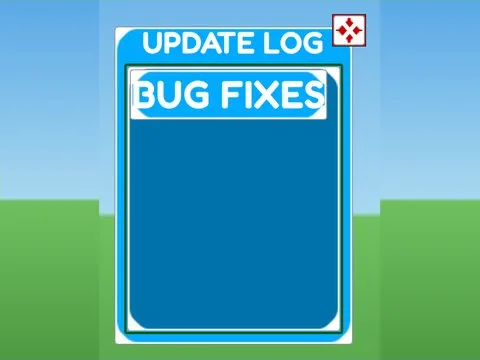 | [Update Log · Hatching Simulator](Update%20Log%20%C2%B7%20Hatching%20Simulator.md) | Interface (ScreenGui) · 13 éléments UI |
| 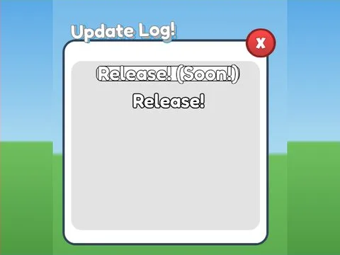 | [Update Log · Pet Pharmica](Update%20Log%20%C2%B7%20Pet%20Pharmica.md) | Interface (ScreenGui) · 16 éléments UI |
| 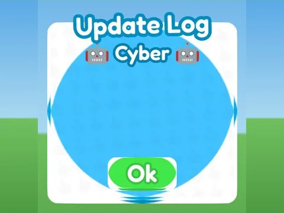 | [Update Log · Rebirth Champions X](Update%20Log%20%C2%B7%20Rebirth%20Champions%20X.md) | Interface (ScreenGui) · 11 éléments UI |
