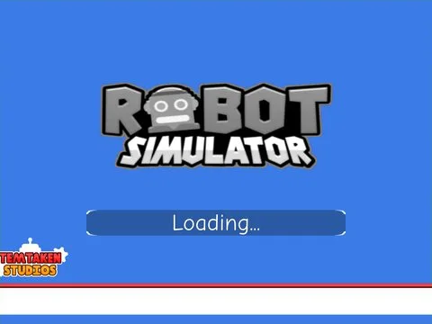

# UIModules · Robot Simulator

Interface « UIModules » du jeu Robot Simulator. 96 éléments UI.

- **Catégorie** : [Interfaces](../Interfaces.md)
- **Sous-catégorie** : [Divers](Divers%20%28Interfaces%29.md)
- **Type** : Interface (ScreenGui)
- **Contenu** : 96 éléments UI
- **Jeu d'origine** : Robot Simulator
- **Fichier source** : `ui/ByType/Misc/RobotSim_UIModules.rbxm` (dans ta bibliothèque `rblx\lib`)
