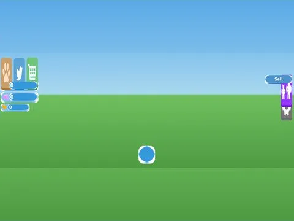

# Core Full · Tweeting Simulator

Interface « Core Full » du jeu Tweeting Simulator. 49 éléments UI.

- **Catégorie** : [Interfaces](../Interfaces.md)
- **Sous-catégorie** : [HUD & monnaie](HUD%20&%20monnaie.md)
- **Type** : Interface (ScreenGui)
- **Contenu** : 49 éléments UI
- **Jeu d'origine** : Tweeting Simulator
- **Fichier source** : `Assets/ui/ByType/HUD_Currency/TweetingSim_Core_Full.rbxm` (dans le vault)
