# HUD & monnaie

Sous-catégorie de [Interfaces](../Interfaces.md) · **27 éléments**

| Aperçu | Élément | Infos |
| --- | --- | --- |
|  | [Cash HUD · Glass Bridge](Cash%20HUD%20%C2%B7%20Glass%20Bridge.md) | Interface (ScreenGui) · 6 éléments UI |
|  | [Core Full · Tweeting Simulator](Core%20Full%20%C2%B7%20Tweeting%20Simulator.md) | Interface (ScreenGui) · 49 éléments UI |
| 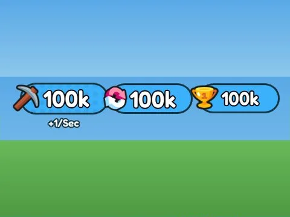 | [Currency · Mining Masters](Currency%20%C2%B7%20Mining%20Masters.md) | Interface (ScreenGui) · 14 éléments UI |
|  | [Currency Counter · Cashgrab Bridge](Currency%20Counter%20%C2%B7%20Cashgrab%20Bridge.md) | Interface (ScreenGui) · 5 éléments UI |
| 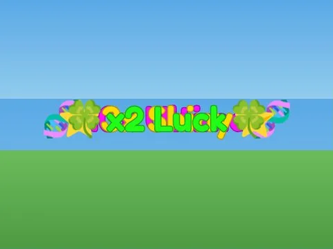 | [Event Boosts · Hatching Simulator](Event%20Boosts%20%C2%B7%20Hatching%20Simulator.md) | Interface (ScreenGui) · 4 éléments UI |
|  | [HUD · Hatching Simulator](HUD%20%C2%B7%20Hatching%20Simulator.md) | Interface (ScreenGui) · 15 éléments UI |
| 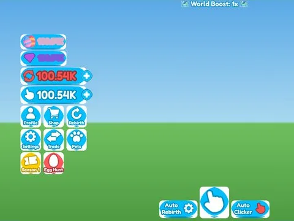 | [HUD · Rebirth Champions X](HUD%20%C2%B7%20Rebirth%20Champions%20X.md) | Interface (ScreenGui) · 89 éléments UI |
| 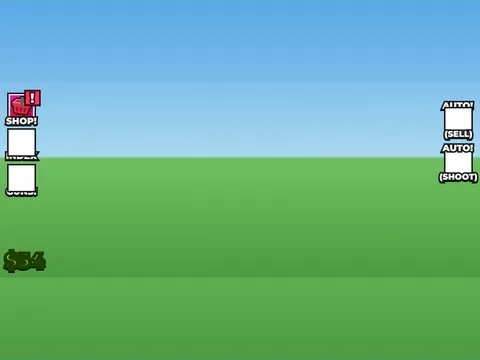 | [HUD · Shoot A Brainrot](HUD%20%C2%B7%20Shoot%20A%20Brainrot.md) | Interface (ScreenGui) · 46 éléments UI |
| 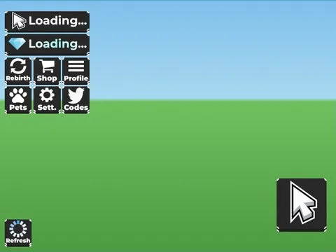 | [HUD · Tapping Lords](HUD%20%C2%B7%20Tapping%20Lords.md) | Interface (ScreenGui) · 39 éléments UI |
|  | [HUD · Training Simulator](HUD%20%C2%B7%20Training%20Simulator.md) | Interface (ScreenGui) · 77 éléments UI |
| 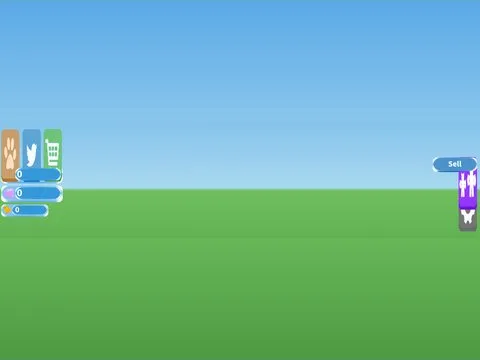 | [HUD · Tweeting Simulator](HUD%20%C2%B7%20Tweeting%20Simulator.md) | Interface (ScreenGui) · 39 éléments UI |
|  | [HUD Buttons Money · Lib perso](HUD%20Buttons%20Money%20%C2%B7%20Lib%20perso.md) | Interface (ScreenGui) · 52 éléments UI |
|  | [Hud Left Right Top · Lib perso](Hud%20Left%20Right%20Top%20%C2%B7%20Lib%20perso.md) | Interface (ScreenGui) · 95 éléments UI |
|  | [Left HUD · Pet Pharmica](Left%20HUD%20%C2%B7%20Pet%20Pharmica.md) | Interface (ScreenGui) · 51 éléments UI |
| 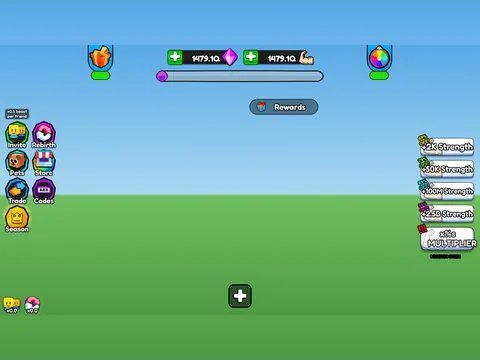 | [Main · Punch Simulator](Main%20%C2%B7%20Punch%20Simulator.md) | Interface (ScreenGui) · 99 éléments UI |
| 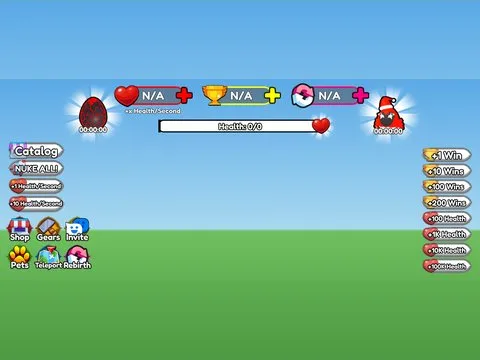 | [Main Full · +1 Health Every Second](Main%20Full%20%C2%B7%20%2B1%20Health%20Every%20Second.md) | Interface (ScreenGui) · 342 éléments UI |
| 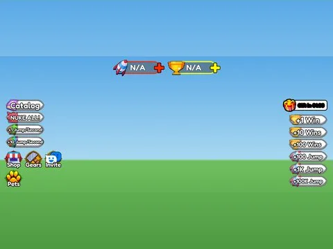 | [Main Full · +1 Jump Every Second](Main%20Full%20%C2%B7%20%2B1%20Jump%20Every%20Second.md) | Interface (ScreenGui) · 309 éléments UI |
|  | [Main Full · Bakery Simulator](Main%20Full%20%C2%B7%20Bakery%20Simulator.md) | Interface (ScreenGui) · 90 éléments UI |
| 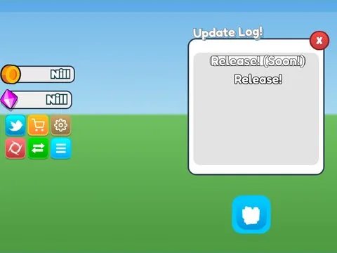 | [Main Full · Pet Pharmica](Main%20Full%20%C2%B7%20Pet%20Pharmica.md) | Interface (ScreenGui) · 69 éléments UI |
| 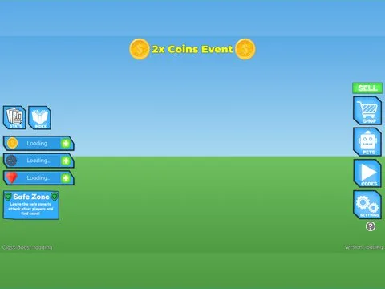 | [Main Full · Robot Simulator](Main%20Full%20%C2%B7%20Robot%20Simulator.md) | Interface (ScreenGui) · 29 éléments UI |
|  | [Main Full · Shoot A Brainrot](Main%20Full%20%C2%B7%20Shoot%20A%20Brainrot.md) | Interface (ScreenGui) · 48 éléments UI |
|  | [Main UI Full · Rebirth Champions X](Main%20UI%20Full%20%C2%B7%20Rebirth%20Champions%20X.md) | Interface (ScreenGui) · 91 éléments UI |
| 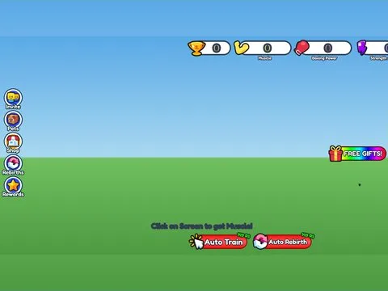 | [Main UI Full · Training Simulator](Main%20UI%20Full%20%C2%B7%20Training%20Simulator.md) | Interface (ScreenGui) · 79 éléments UI |
| 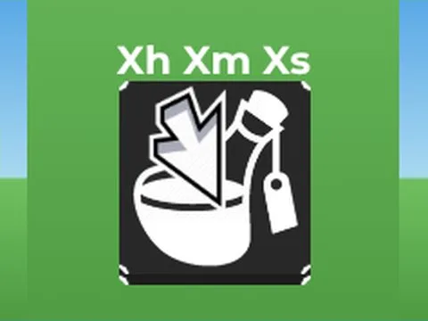 | [Potion Timers · Tapping Lords](Potion%20Timers%20%C2%B7%20Tapping%20Lords.md) | Interface (ScreenGui) · 5 éléments UI |
| 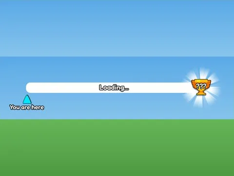 | [Progress Bar · +1 Jump Every Second](Progress%20Bar%20%C2%B7%20%2B1%20Jump%20Every%20Second.md) | Interface (ScreenGui) · 8 éléments UI |
|  | [Side Buttons · Mining Masters](Side%20Buttons%20%C2%B7%20Mining%20Masters.md) | Interface (ScreenGui) · 70 éléments UI |
| 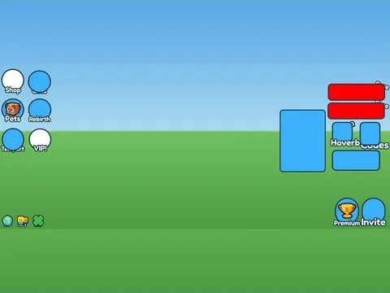 | [UI Full · Mining Masters](UI%20Full%20%C2%B7%20Mining%20Masters.md) | Interface (ScreenGui) · 76 éléments UI |
