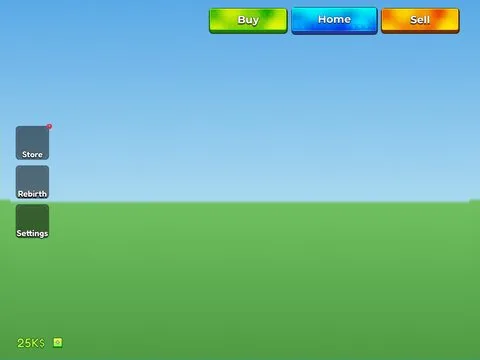

# HUD Buttons Money · Lib perso

Interface « HUD Buttons Money » du jeu Lib perso. 52 éléments UI.

- **Catégorie** : [Interfaces](../Interfaces.md)
- **Sous-catégorie** : [HUD & monnaie](HUD%20&%20monnaie.md)
- **Type** : Interface (ScreenGui)
- **Contenu** : 52 éléments UI
- **Jeu d'origine** : Lib perso
- **Fichier source** : `ui/ByType/HUD_Currency/Lib_HUD_ButtonsMoney.rbxm` (dans ta bibliothèque `rblx\lib`)
