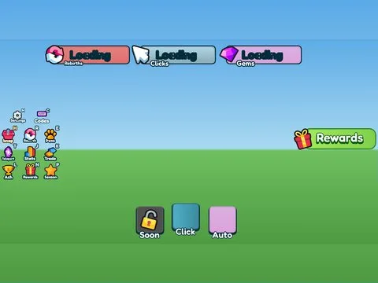

# Hud Left Right Top · Lib perso

Interface « Hud Left Right Top » du jeu Lib perso. 95 éléments UI.

- **Catégorie** : [Interfaces](../Interfaces.md)
- **Sous-catégorie** : [HUD & monnaie](HUD%20&%20monnaie.md)
- **Type** : Interface (ScreenGui)
- **Contenu** : 95 éléments UI
- **Jeu d'origine** : Lib perso
- **Fichier source** : `Assets/ui/ByType/HUD_Currency/Lib_Hud_LeftRightTop.rbxm` (dans le vault)
