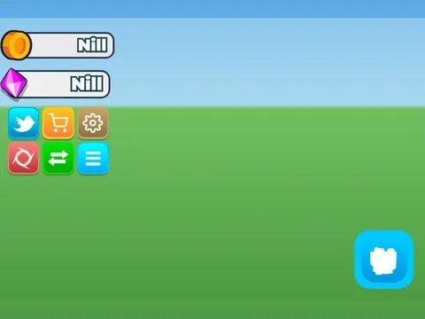

# Left HUD · Pet Pharmica

Interface « Left HUD » du jeu Pet Pharmica. 51 éléments UI.

- **Catégorie** : [Interfaces](../Interfaces.md)
- **Sous-catégorie** : [HUD & monnaie](HUD%20%26%20monnaie.md)
- **Type** : Interface (ScreenGui)
- **Contenu** : 51 éléments UI
- **Jeu d'origine** : Pet Pharmica
- **Fichier source** : `ui/ByType/HUD_Currency/PetPharmica_LeftHUD.rbxm` (dans ta bibliothèque `rblx\lib`)
