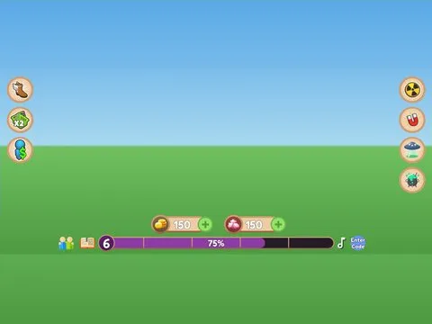

# Main Full · Bakery Simulator

Interface « Main Full » du jeu Bakery Simulator. 90 éléments UI.

- **Catégorie** : [Interfaces](../Interfaces.md)
- **Sous-catégorie** : [HUD & monnaie](HUD%20%26%20monnaie.md)
- **Type** : Interface (ScreenGui)
- **Contenu** : 90 éléments UI
- **Jeu d'origine** : Bakery Simulator
- **Fichier source** : `ui/ByType/HUD_Currency/BakerySim_Main_Full.rbxm` (dans ta bibliothèque `rblx\lib`)
