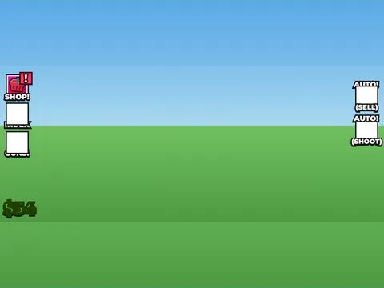

# Main Full · Shoot A Brainrot

Interface « Main Full » du jeu Shoot A Brainrot. 48 éléments UI.

- **Catégorie** : [Interfaces](../Interfaces.md)
- **Sous-catégorie** : [HUD & monnaie](HUD%20%26%20monnaie.md)
- **Type** : Interface (ScreenGui)
- **Contenu** : 48 éléments UI
- **Jeu d'origine** : Shoot A Brainrot
- **Fichier source** : `ui/ByType/HUD_Currency/ShootABrainrot_Main_Full.rbxm` (dans ta bibliothèque `rblx\lib`)
