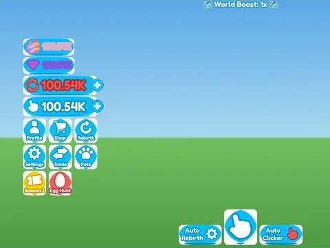

# Main UI Full · Rebirth Champions X

Interface « Main UI Full » du jeu Rebirth Champions X. 91 éléments UI.

- **Catégorie** : [Interfaces](../Interfaces.md)
- **Sous-catégorie** : [HUD & monnaie](HUD%20%26%20monnaie.md)
- **Type** : Interface (ScreenGui)
- **Contenu** : 91 éléments UI
- **Jeu d'origine** : Rebirth Champions X
- **Fichier source** : `ui/ByType/HUD_Currency/RebirthChampionsX_MainUI_Full.rbxm` (dans ta bibliothèque `rblx\lib`)
