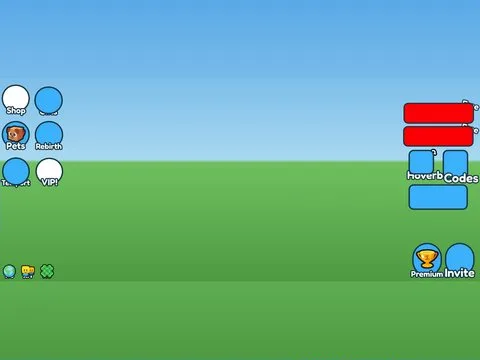

# Side Buttons · Mining Masters

Interface « Side Buttons » du jeu Mining Masters. 70 éléments UI.

- **Catégorie** : [Interfaces](../Interfaces.md)
- **Sous-catégorie** : [HUD & monnaie](HUD%20&%20monnaie.md)
- **Type** : Interface (ScreenGui)
- **Contenu** : 70 éléments UI
- **Jeu d'origine** : Mining Masters
- **Fichier source** : `ui/ByType/HUD_Currency/MiningMasters_SideButtons.rbxm` (dans ta bibliothèque `rblx\lib`)
