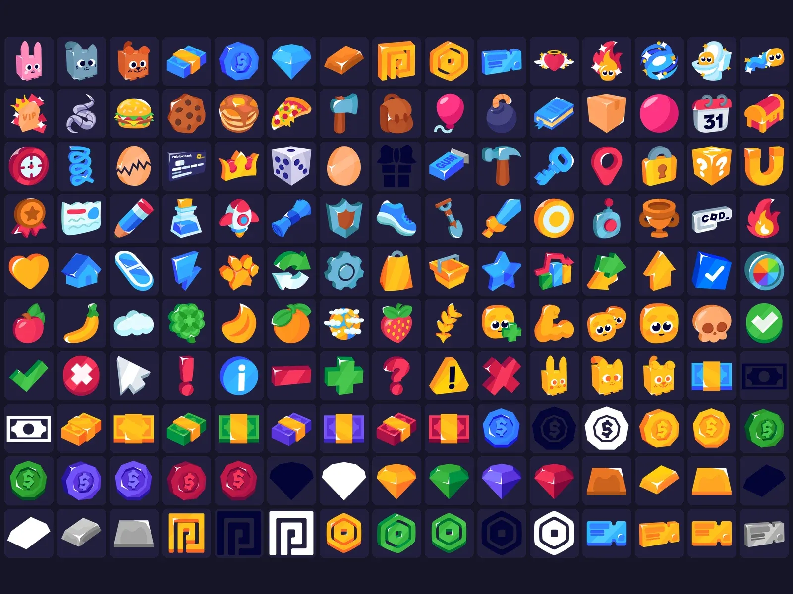

# Free Icon Pack 2.0

Pack « Free Icon Pack 2.0 » : 1674 images PNG (aperçu de 150). Télécharge le .zip puis importe les images dans Roblox Studio (Asset Manager ou Bulk Import).

- **Catégorie** : [Interfaces](../Interfaces.md)
- **Sous-catégorie** : [Icônes & images](Ic%C3%B4nes%20%26%20images.md)
- **Type** : Pack d'images
- **Fichier source** : `ui/Icons/Free Icon Pack 2.0 (Basic).zip` (dans ta bibliothèque `rblx\lib`)

## Maquette

### Page entière

