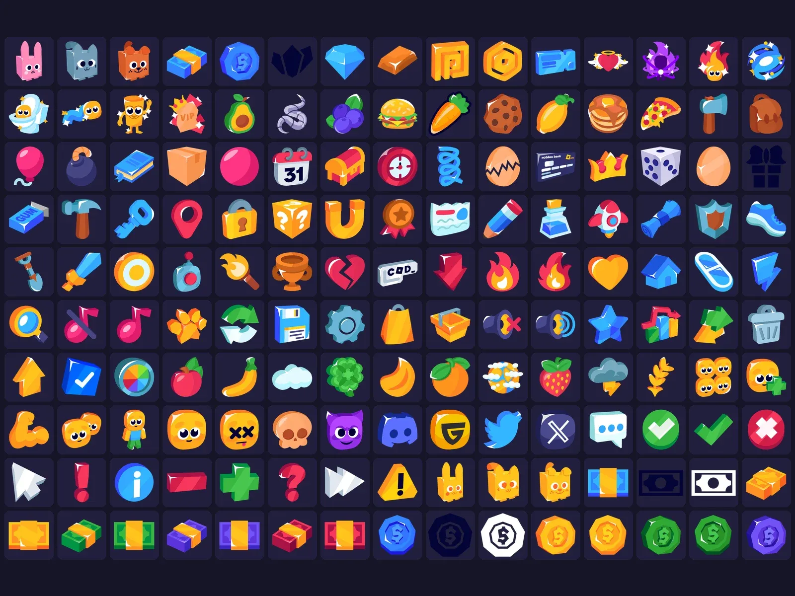

# Free Icon Pack 3.0.1

Pack « Free Icon Pack 3.0.1 » : 2044 images PNG (aperçu de 150). Télécharge le .zip puis importe les images dans Roblox Studio (Asset Manager ou Bulk Import).

- **Catégorie** : [Interfaces](../Interfaces.md)
- **Sous-catégorie** : [Icônes & images](Ic%C3%B4nes%20&%20images.md)
- **Type** : Pack d'images
- **Fichier source** : `Assets/ui/Icons/Free Icon Pack 3.0.1 (Basic).zip` (dans le vault)

## Maquette

### Page entière

