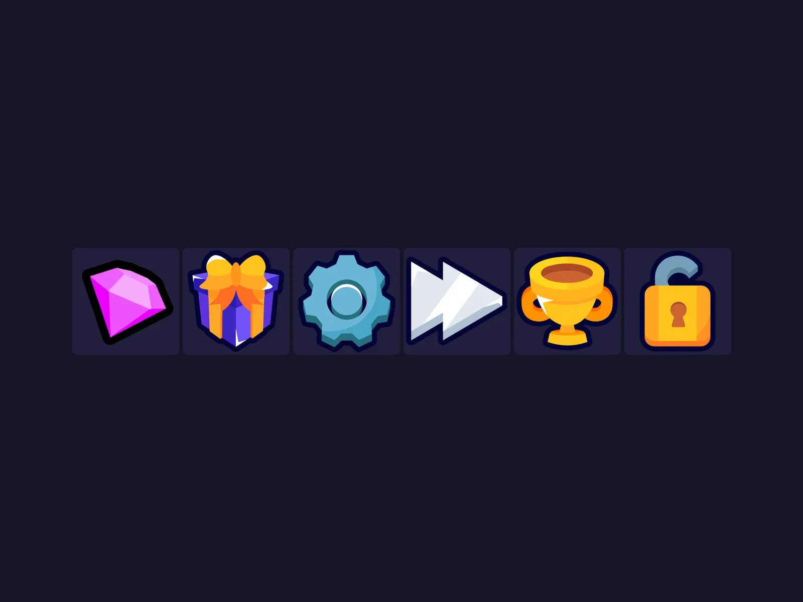

# Icônes k4lsh

Pack « Icônes k4lsh » : 6 images PNG. Télécharge le .zip puis importe les images dans Roblox Studio (Asset Manager ou Bulk Import).

- **Catégorie** : [Interfaces](../Interfaces.md)
- **Sous-catégorie** : [Icônes & images](Ic%C3%B4nes%20&%20images.md)
- **Type** : Pack d'images
- **Fichier source** : `ui/Icons/k4lsh` (dans ta bibliothèque `rblx\lib`)

## Maquette

### Page entière

