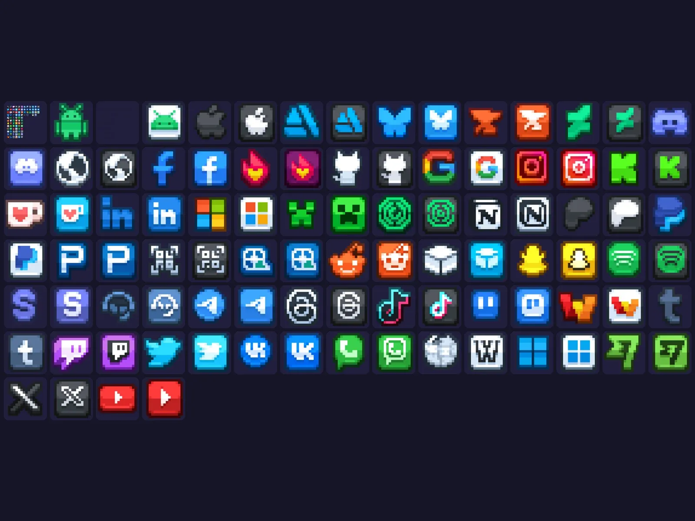

# Social Icons Pack EU

Pack « Social Icons Pack EU » : 284 images PNG (aperçu de 94). Télécharge le .zip puis importe les images dans Roblox Studio (Asset Manager ou Bulk Import).

- **Catégorie** : [Interfaces](../Interfaces.md)
- **Sous-catégorie** : [Icônes & images](Ic%C3%B4nes%20&%20images.md)
- **Type** : Pack d'images
- **Fichier source** : `ui/Icons/Social Icons Pack EU (PNG).zip` (dans ta bibliothèque `rblx\lib`)

## Maquette

### Page entière

