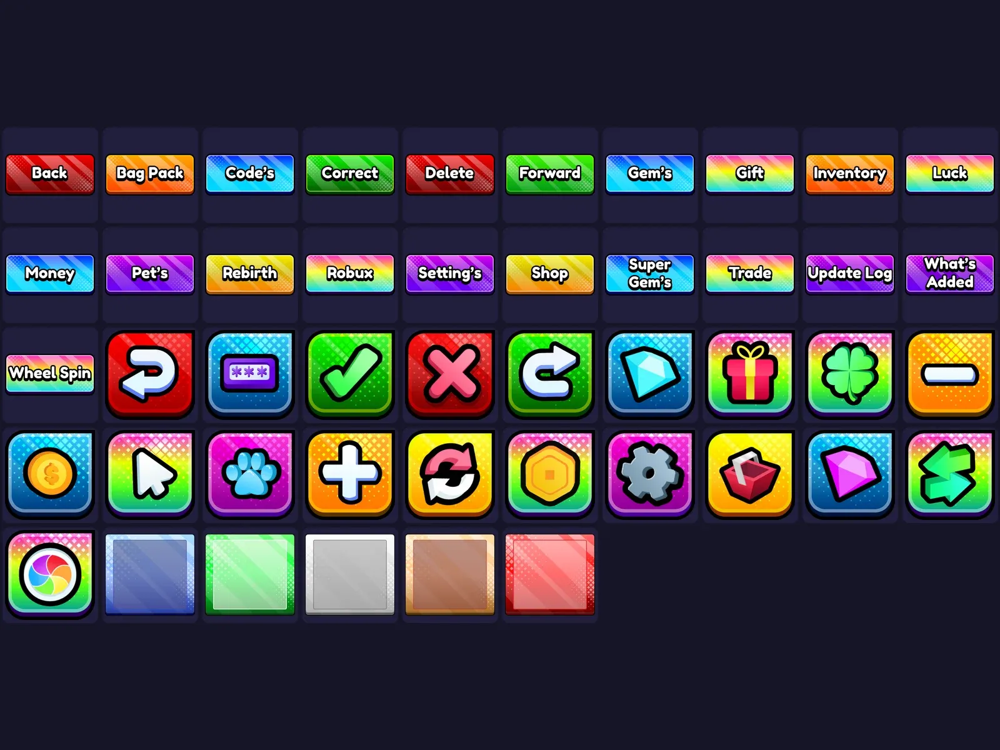

# UI Mega Pack — PNG

Pack « UI Mega Pack — PNG » : 46 images PNG. Télécharge le .zip puis importe les images dans Roblox Studio (Asset Manager ou Bulk Import).

- **Catégorie** : [Interfaces](../Interfaces.md)
- **Sous-catégorie** : [Icônes & images](Ic%C3%B4nes%20&%20images.md)
- **Type** : Pack d'images
- **Fichier source** : `Assets/ui/Roblox Ui Model/png` (dans le vault)

## Maquette

### Page entière

