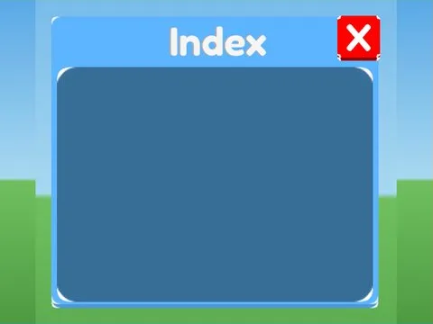
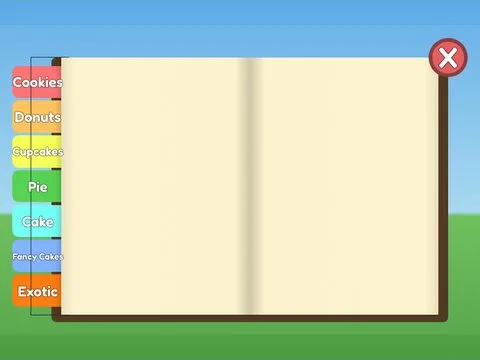

# Index & collection

Sous-catégorie de [Interfaces](../Interfaces.md) · **7 éléments**

| Aperçu | Élément | Infos |
| --- | --- | --- |
|  | [Index · Rebirth Champions X](Index%20%C2%B7%20Rebirth%20Champions%20X.md) | Interface (ScreenGui) · 24 éléments UI |
|  | [Index · Robot Simulator](Index%20%C2%B7%20Robot%20Simulator.md) | Interface (ScreenGui) · 7 éléments UI |
|  | [Index · Tapping Lords](Index%20%C2%B7%20Tapping%20Lords%20%C2%B7%20Index%20%26%20collection.md) | Interface (ScreenGui) · 9 éléments UI |
|  | [Index Button · Lib perso](Index%20Button%20%C2%B7%20Lib%20perso.md) | Interface (ScreenGui) · 3 éléments UI |
|  | [Mob Index · Shoot A Brainrot](Mob%20Index%20%C2%B7%20Shoot%20A%20Brainrot.md) | Interface (ScreenGui) · 32 éléments UI |
|  | [Pet Index · Hatching Simulator](Pet%20Index%20%C2%B7%20Hatching%20Simulator.md) | Interface (ScreenGui) · 22 éléments UI |
|  | [Recipe Book · Bakery Simulator](Recipe%20Book%20%C2%B7%20Bakery%20Simulator.md) | Interface (ScreenGui) · 24 éléments UI |
