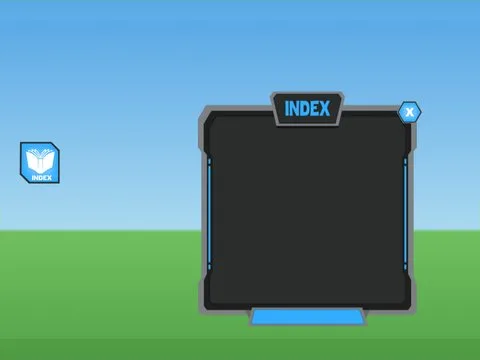

# Index · Robot Simulator

Interface « Index » du jeu Robot Simulator. 7 éléments UI.

- **Catégorie** : [Interfaces](../Interfaces.md)
- **Sous-catégorie** : [Index & collection](Index%20&%20collection.md)
- **Type** : Interface (ScreenGui)
- **Contenu** : 7 éléments UI
- **Jeu d'origine** : Robot Simulator
- **Fichier source** : `Assets/ui/ByType/Index_Collection/RobotSim_Index.rbxm` (dans le vault)
