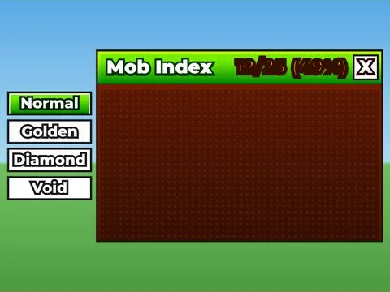

# Mob Index · Shoot A Brainrot

Interface « Mob Index » du jeu Shoot A Brainrot. 32 éléments UI.

- **Catégorie** : [Interfaces](../Interfaces.md)
- **Sous-catégorie** : [Index & collection](Index%20&%20collection.md)
- **Type** : Interface (ScreenGui)
- **Contenu** : 32 éléments UI
- **Jeu d'origine** : Shoot A Brainrot
- **Fichier source** : `ui/ByType/Index_Collection/ShootABrainrot_MobIndex.rbxm` (dans ta bibliothèque `rblx\lib`)
